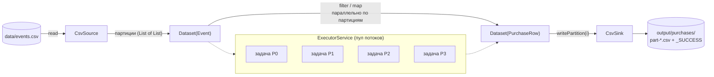
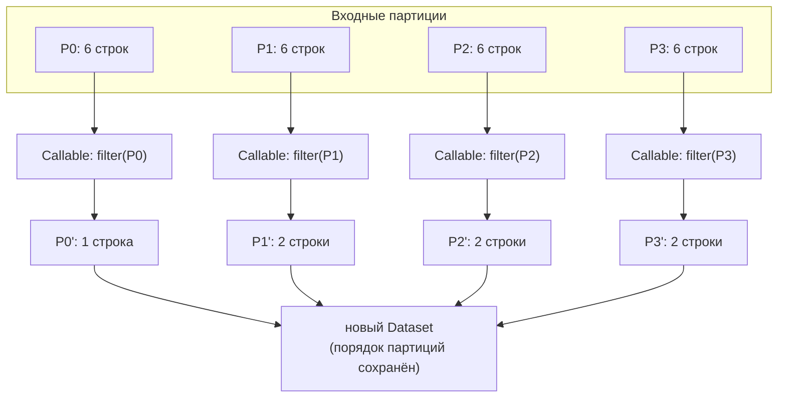
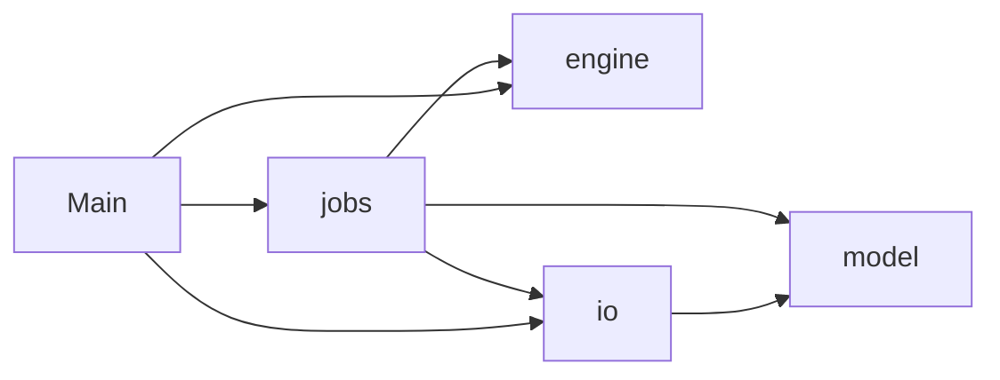
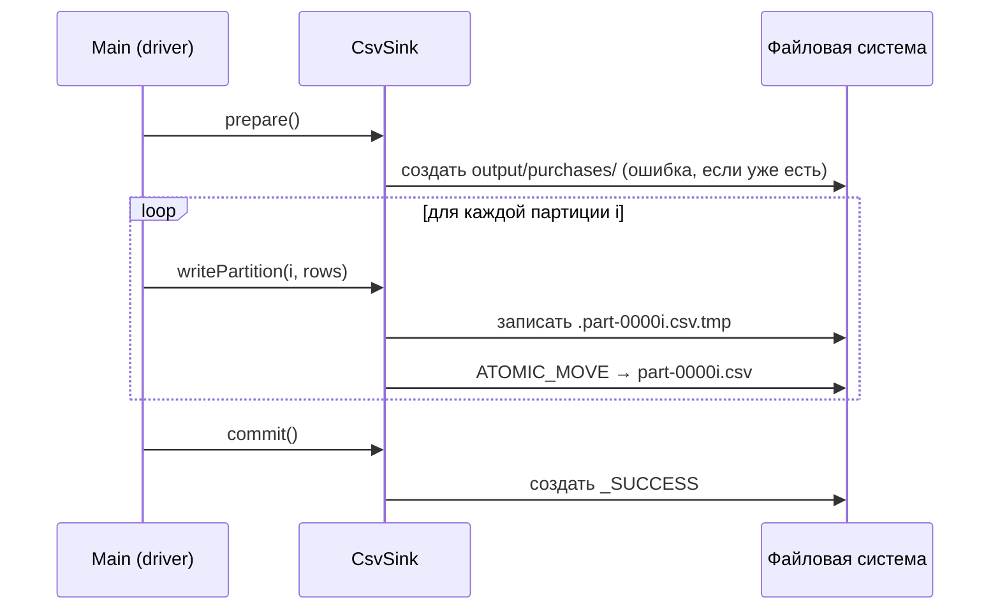

<div align="center">

# ⚡ Sparklet

**Учебный мини-движок пакетной обработки данных на Java 17, построенный по мотивам Apache Spark**

_читаем → преобразуем → надёжно сохраняем, партиция за партицией, в пуле потоков_


</div>

---

## 📚 Содержание

1. [О проекте](#-о-проекте)
2. [Возможности и статус](#-возможности-и-статус)
3. [Архитектура](#-архитектура)
4. [Ключевые идеи](#-ключевые-идеи)
5. [Структура проекта](#-структура-проекта)
6. [Быстрый старт](#-быстрый-старт)
7. [Пример: от CSV до результата](#-пример-от-csv-до-результата)
8. [Справочник по API](#-справочник-по-api)
9. [Протокол записи и отказоустойчивость](#-протокол-записи-и-отказоустойчивость)
10. [Проектные решения](#-проектные-решения)
11. [Ограничения](#-ограничения)
12. [Диагностика проблем](#-диагностика-проблем)
13. [Дорожная карта](#-дорожная-карта)
14. [Чему учит этот проект](#-чему-учит-этот-проект)

---

## 🎯 О проекте

**Sparklet** — небольшой движок обработки данных, написанный с одной целью: **понять, как устроен Spark изнутри**, и заодно освоить Java на реалистичной инженерной задаче.

В отличие от «hello world» и учебных калькуляторов, здесь с первых шагов решаются настоящие задачи ETL-систем:

- данные **делятся на партиции**, и каждая партиция обрабатывается **независимой задачей** в пуле потоков;
- преобразования описываются **функциями** (`map`, `filter`), как в Spark API;
- результат сохраняется **атомарно**: потребитель либо видит полный результат с маркером `_SUCCESS`, либо не видит ничего;
- общее состояние между потоками **не разделяется**, поэтому код безопасен для параллельного запуска.

> ℹ️ Sparklet не претендует на замену Spark. Это **макет в масштабе 1:100**, на котором видны все ключевые механизмы: партиции, задачи, исполнители, commit-протокол.

### Идея в одной картинке

```
data/events.csv ──► [P0][P1][P2][P3] ──► filter ──► map ──► [P0'][P1'][P2'][P3'] ──► output/purchases/
                     партиции            └ по задаче на партицию в пуле ┘               part-0000i.csv + _SUCCESS
```

---

## ✅ Возможности и статус

| Этап            | Компонент                  | Статус | Описание                                                                                |
| --------------- | -------------------------- | :----: | --------------------------------------------------------------------------------------- |
| **Read**        | `CsvSource`                |   ✅   | чтение CSV, пропуск заголовка, разбиение на `N` партиций                                |
| **Transform**   | `Dataset<T>`               |   ✅   | неизменяемый набор партиций; `map`, `filter`, `collect`, `count`                        |
| **Transform**   | `PurchaseJob`              |   ✅   | пример прикладного джоба: оставить покупки и обогатить их признаком `bucket`            |
| **Write**       | `CsvSink`                  |   ✅   | запись `part-*.csv` через временные файлы и атомарное переименование, маркер `_SUCCESS` |
| **Orchestrate** | `Job`                      |   ⬜   | параллельная запись, статусы задач, повторы, решение `commit`/`abort`                   |
| **Engine**      | ленивое вычисление, stages |   ⬜   | цепочка операций за один проход по партиции                                             |
| **Engine**      | `reduceByKey` (shuffle)    |   ⬜   | первая настоящая граница stage                                                          |
| **I/O**         | JDBC source/sink           |   ⬜   | чтение и запись в реляционную БД                                                        |

Легенда: ✅ реализовано · ⬜ запланировано (подробности в [дорожной карте](#-дорожная-карта)).

---

## 🏗 Архитектура

### Общая схема



### Как Sparklet соотносится со Spark

| Spark                            | Sparklet                                                | Комментарий                                     |
| -------------------------------- | ------------------------------------------------------- | ----------------------------------------------- |
| Driver                           | `Main` (позже `Job`)                                    | собирает план и управляет выполнением           |
| Executor                         | поток из `ExecutorService`                              | в Spark это отдельные процессы на кластере      |
| Partition                        | `List<T>`                                               | кусок данных, который обрабатывается независимо |
| Task                             | `Callable` на одну партицию                             | единица работы, один поток                      |
| `RDD` / `Dataset`                | `Dataset<T>`                                            | неизменяемая коллекция партиций                 |
| Transformation (`map`, `filter`) | `Dataset.map`, `Dataset.filter`                         | пока **жадные**, не ленивые                     |
| `FileOutputCommitter`            | `CsvSink` (`prepare`/`writePartition`/`commit`/`abort`) | та же идея: part-файлы и `_SUCCESS`             |
| `part-00000`, `_SUCCESS`         | `part-00000.csv`, `_SUCCESS`                            | формат выходной директории                      |

### Поток выполнения внутри `Dataset`



---

## 💡 Ключевые идеи

### 1. Партиция — единица параллелизма

Данные делятся на `N` блоков подряд. Если число строк не делится на `N` нацело, остаток раздаётся по одной строке первым партициям, поэтому размеры отличаются **не более чем на 1**.

| Строк в файле | Партиций | Размеры                            |
| ------------: | -------: | ---------------------------------- |
|            24 |        4 | 6, 6, 6, 6                         |
|            24 |        5 | 5, 5, 5, 5, 4                      |
|            24 |       30 | 24 партиции по 1 строке и 6 пустых |

### 2. Одна партиция = одна задача

Каждая операция `Dataset` превращает партиции в `Callable`, отправляет их в пул через `invokeAll` и собирает результаты **в порядке партиций**, независимо от того, какая задача завершилась первой. Поэтому `collect()` всегда возвращает строки в порядке исходного файла.

### 3. Неизменяемость

`map` и `filter` не модифицируют исходный `Dataset`, а возвращают новый. Внутри хранятся неизменяемые копии (`List.copyOf`), поэтому один и тот же `Dataset` можно безопасно использовать из разных потоков и разных цепочек преобразований.

### 4. Лямбды должны быть чистыми

Партиции обрабатываются параллельно, поэтому функция внутри `map`/`filter` **не должна менять общее состояние**:

```java
int[] counter = {0};
ds.map(e -> { counter[0]++; return e; });   // ❌ гонка данных: часть инкрементов потеряется
```

Для подсчётов используйте `AtomicLong` (в Spark аналогом служат accumulators).

### 5. Запись как транзакция

Результат записи либо виден целиком, либо не виден вовсе. Подробности в разделе [Протокол записи](#-протокол-записи-и-отказоустойчивость).

---

## 🗂 Структура проекта

```
sparklet/
 ├─ pom.xml
 ├─ README.md
 ├─ .gitignore
 │
 ├─ data/                                   ← ВХОД (кладёте файлы вы)
 │    └─ events.csv
 │
 ├─ output/                                 ← ВЫХОД (создаёт программа, в git не попадает)
 │    └─ purchases/
 │         ├─ part-00000.csv
 │         ├─ …
 │         └─ _SUCCESS
 │
 ├─ target/                                 ← сборка Maven (в git не попадает)
 │
 └─ src/
     ├─ main/java/com/maksim/sparklet/
     │    ├─ Main.java                      ← сборка и запуск цепочки
     │    ├─ model/                         ← доменные данные
     │    │    ├─ Event.java                   record Event(userId, event, amount)
     │    │    └─ PurchaseRow.java             record PurchaseRow(userId, amount, bucket)
     │    ├─ io/                            ← ввод-вывод
     │    │    ├─ Source.java, CsvSource.java
     │    │    └─ Sink.java,   CsvSink.java
     │    ├─ engine/                        ← механика выполнения
     │    │    └─ Dataset.java
     │    └─ jobs/                          ← прикладная логика поверх движка
     │         └─ PurchaseJob.java
     └─ test/java/com/maksim/sparklet/      ← тесты (структура зеркалит main)
```

### Правило зависимостей



**`engine` не импортирует ни `model`, ни `io`.** Движок ничего не знает о том, какие данные через него идут. Проверка простая: если `Dataset` можно использовать со `String` или `Integer` без единой правки, граница соблюдена.

---

## 🚀 Быстрый старт

### Требования

| Инструмент | Версия   | Проверка                                |
| ---------- | -------- | --------------------------------------- |
| JDK        | 17 (LTS) | `java -version`                         |
| Maven      | 3.8+     | `mvn -v` (в выводе должна быть Java 17) |

Внешних runtime-зависимостей нет, только стандартная библиотека Java.

### Сборка и запуск

```bash
# из корня проекта (там, где лежит pom.xml)
mvn compile exec:java
```

| Команда                                            | Что делает                                                             |
| -------------------------------------------------- | ---------------------------------------------------------------------- |
| `mvn compile`                                      | компилирует `src/main/java` в `target/classes`                         |
| `mvn compile exec:java`                            | компилирует и запускает `Main`                                         |
| `mvn clean compile exec:java`                      | то же, но с очисткой `target/` (если подозреваете устаревшие `.class`) |
| `mvn test`                                         | запускает JUnit-тесты                                                  |
| `mvn package`                                      | собирает jar в `target/`                                               |
| `java -cp target/classes com.maksim.sparklet.Main` | запуск без Maven                                                       |

> ⚠️ Пути вида `data/events.csv` считаются **от рабочей директории процесса**. Запускайте команды из корня проекта.

> ⚠️ Если директория `output/purchases/` уже существует, `CsvSink.prepare()` завершится ошибкой `FileAlreadyExistsException`. Это сделано намеренно (так же ведёт себя Spark). Перед повторным запуском удалите `output/` вручную.

### Рекомендуемый `.gitignore`

```gitignore
target/
output/
.idea/
*.iml
.vscode/
```

---

## 🔬 Пример: от CSV до результата

### Входные данные

`data/events.csv` — 24 события, 8 пользователей:

```csv
user_id,event,amount
1,view,0
1,click,0
1,buy,25.50
2,view,0
...
3,buy,99.99
3,refund,-99.99
...
5,buy,250.00
5,buy,40.25
...
8,buy,130.00
8,click,0
```

| Тип события     | Сумма | Сколько в файле |
| --------------- | ----- | --------------: |
| `view`, `click` | 0     |              15 |
| `buy`           | > 0   |               7 |
| `refund`        | < 0   |               2 |

Отрицательные суммы нужны, чтобы фильтр `amount > 0` что-то реально отсекал.

### Преобразования (`PurchaseJob`)

```java
public final class PurchaseJob {
    private PurchaseJob() {}

    public static Dataset<PurchaseRow> build(Dataset<Event> events) {
        return events
            .filter(e -> e.amount() > 0)     // оставляем только покупки
            .map(PurchaseRow::from);         // Event → PurchaseRow
    }
}
```

```java
public record PurchaseRow(int userId, double amount, String bucket) {
    public static PurchaseRow from(Event e) {
        return new PurchaseRow(e.userId(), e.amount(), e.amount() >= 100 ? "high" : "low");
    }
}
```

### Сборка цепочки (`Main`)

```java
ExecutorService pool = Executors.newFixedThreadPool(4);
try {
    // READ
    Source<Event> source = new CsvSource<>(Path.of("data/events.csv"), 4, Event::parse);
    Dataset<Event> events = Dataset.of(source.read(), pool);

    // TRANSFORM
    Dataset<PurchaseRow> purchases = PurchaseJob.build(events);

    // WRITE
    Sink<PurchaseRow> sink = new CsvSink<>(
        Path.of("output/purchases"),
        "user_id,amount,bucket",
        r -> r.userId() + "," + r.amount() + "," + r.bucket()
    );

    sink.prepare();
    try {
        List<List<PurchaseRow>> parts = purchases.partitions();
        for (int i = 0; i < parts.size(); i++) {
            sink.writePartition(i, parts.get(i));
        }
        sink.commit();
    } catch (IOException | RuntimeException e) {
        sink.abort();
        throw e;
    }
} finally {
    pool.shutdown();
}
```

### Ожидаемый результат

Размеры партиций после `filter`:

| Партиция  | Было | Стало |
| --------- | ---: | ----: |
| P0        |    6 |     1 |
| P1        |    6 |     2 |
| P2        |    6 |     2 |
| P3        |    6 |     2 |
| **Итого** |   24 | **7** |

Сумма `amount` по всем покупкам: **565.54**.

Содержимое `output/purchases/`:

```
output/purchases/
 ├─ part-00000.csv        user_id,amount,bucket
 │                        1,25.5,low
 ├─ part-00001.csv        user_id,amount,bucket
 │                        3,99.99,low
 │                        4,12.0,low
 ├─ part-00002.csv        user_id,amount,bucket
 │                        5,250.0,high
 │                        5,40.25,low
 ├─ part-00003.csv        user_id,amount,bucket
 │                        7,7.8,low
 │                        8,130.0,high
 └─ _SUCCESS
```

Обратите внимание, что размеры партиций после фильтрации стали **неравными** (1, 2, 2, 2). Это нормальная ситуация и в Spark (перекос данных, _data skew_).

### Бонус: `Dataset` универсален

Движок не привязан к CSV и событиям. Тот же `Dataset` работает с любыми типами:

```java
ExecutorService pool = Executors.newFixedThreadPool(2);
Dataset<Integer> ds = Dataset.of(List.of(List.of(1, 2, 3), List.of(4, 5), List.of(6)), pool);

System.out.println(ds.filter(x -> x % 2 == 0).map(x -> x * 10).collect());   // [20, 40, 60]
System.out.println(ds.count());                                               // 6
pool.shutdown();
```

---

## 📖 Справочник по API

### `Source<T>` — откуда берём данные

```java
public interface Source<T> {
    List<List<T>> read() throws IOException;   // данные, уже разбитые на партиции
}
```

**`CsvSource<T>`**: `new CsvSource<>(Path path, int numPartitions, Function<String, T> parser)`

- пропускает первую строку (заголовок) и пустые строки;
- парсит каждую строку функцией `parser` (`Function<String, T>`: **строка → объект**);
- делит результат на `numPartitions` блоков подряд;
- при `numPartitions <= 0` бросает `IllegalArgumentException`.

### `Dataset<T>` — набор партиций и преобразования

| Метод        | Сигнатура                                                                  | Описание                                               |
| ------------ | -------------------------------------------------------------------------- | ------------------------------------------------------ |
| `of`         | `static <T> Dataset<T> of(List<List<T>> partitions, ExecutorService pool)` | создаёт датасет (делает неизменяемые копии)            |
| `map`        | `<R> Dataset<R> map(Function<T, R> f)`                                     | применяет функцию к каждому элементу                   |
| `filter`     | `Dataset<T> filter(Predicate<T> p)`                                        | оставляет элементы, для которых условие истинно        |
| `partitions` | `List<List<T>> partitions()`                                               | неизменяемый список партиций                           |
| `collect`    | `List<T> collect()`                                                        | склеивает партиции в один список (порядок сохраняется) |
| `count`      | `long count()`                                                             | общее число элементов                                  |

Внутри `map` и `filter` использован один приватный примитив `mapPartitions(Function<List<T>, List<R>>)`: именно он создаёт задачи, вызывает `invokeAll` и собирает результаты в порядке партиций.

**Ошибки.** Исключение внутри лямбды оборачивается в `RuntimeException("Partition processing failed", cause)`; `InterruptedException` восстанавливает флаг прерывания потока и тоже превращается в `RuntimeException`.

### `Sink<T>` — куда сохраняем

```java
public interface Sink<T> {
    void prepare() throws IOException;                                  // проверить/создать директорию
    void writePartition(int index, List<T> rows) throws IOException;    // записать одну партицию
    void commit() throws IOException;                                   // зафиксировать успех (_SUCCESS)
    void abort();                                                       // откатить, убрать недописанное
}
```

**`CsvSink<T>`**: `new CsvSink<>(Path dir, String header, Function<T, String> formatter)`

- `formatter` (`Function<T, String>`: **объект → строка**) превращает запись в строку CSV;
- заголовок записывается в **каждый** part-файл;
- кодировка всегда UTF-8.

> 💡 Запомнить различие: у `Source` функция `Function<String, T>` (парсер), у `Sink` функция `Function<T, String>` (форматер). Первый тип в `Function<A, B>` — вход, второй — выход.

---

## 🛡 Протокол записи и отказоустойчивость

Запись организована как мини-транзакция (по образцу commit-протокола Hadoop/Spark).



### Правила

1. **Временный файл в той же директории.** Атомарное переименование (`ATOMIC_MOVE`) работает только в пределах одной файловой системы.
2. **Итоговый файл появляется целиком или не появляется.** Читатель никогда не увидит наполовину записанный `part-*.csv`.
3. **`_SUCCESS` создаётся только после записи всех партиций.** Это сигнал потребителям (в том числе Airflow-сенсорам): «директории можно доверять».
4. **`prepare()` вызывается вне `try`.** Если директория уже существует, `abort()` не должен удалять чужие данные.
5. **`abort()` убирает всё**, что было создано, и не бросает исключений, чтобы не маскировать исходную ошибку.

### Что получается при сбоях

| Сценарий                                    | Что на диске                                                                                                     |
| ------------------------------------------- | ---------------------------------------------------------------------------------------------------------------- |
| Всё успешно                                 | все `part-*.csv` и `_SUCCESS`                                                                                    |
| Сбой при записи партиции `k`                | вызван `abort()`: директория удалена, `_SUCCESS` нет                                                             |
| Процесс убит посреди записи                 | остались только `.tmp` и/или готовые `part-*.csv`, **но нет `_SUCCESS`**, потребитель такой результат игнорирует |
| Повторный запуск при существующем `output/` | `FileAlreadyExistsException`, старые данные не тронуты                                                           |

> 🔁 **Идемпотентность.** Повторная запись той же партиции безопасна: новый `.tmp` атомарно заменит старый `part-*.csv`. Именно на этом свойстве будут построены повторы задач в `Job`.

---

## 🧠 Проектные решения

| Решение                                                                         | Почему                                                                                                                                                      |
| ------------------------------------------------------------------------------- | ----------------------------------------------------------------------------------------------------------------------------------------------------------- |
| Приватный конструктор `Dataset`, создание через `of(...)`                       | гарантия, что внутри всегда неизменяемые копии                                                                                                              |
| Один примитив `mapPartitions` вместо трёх копий кода                            | параллельный запуск, порядок результатов и обработка исключений живут в одном месте                                                                         |
| `List.copyOf` на входе и выходе                                                 | защита от изменения данных снаружи и между потоками                                                                                                         |
| Checked-исключения ловятся внутри `Dataset` и превращаются в `RuntimeException` | цепочку `ds.filter(...).map(...)` удобно писать без `throws`                                                                                                |
| `Thread.currentThread().interrupt()` при `InterruptedException`                 | сигнал прерывания не теряется, пул можно корректно остановить                                                                                               |
| `pool.shutdown()` в `finally`                                                   | иначе потоки пула не завершатся и программа «зависнет» после `main`                                                                                         |
| Функции передаются снаружи (`Function<String, T>`, `Function<T, String>`)       | `CsvSource` и `CsvSink` не знают про конкретные типы и работают с любым `T`                                                                                 |
| `engine` не зависит от `model` и `io`                                           | движок остаётся универсальным и тестируемым отдельно                                                                                                        |
| Числа в CSV формируются конкатенацией (`r.amount()`)                            | всегда точка в качестве разделителя; при использовании `String.format` указывайте `Locale.ROOT`, иначе при русской локали получится `25,50` и CSV сломается |

---

## ⚠️ Ограничения

Sparklet намеренно прост. Что важно знать:

- **Всё в памяти.** `CsvSource` читает файл целиком, а `Dataset` хранит все партиции в памяти. Для больших файлов нужен потоковый режим (итераторы, чтение по диапазонам байт).
- **Один процесс.** «Исполнители» это потоки одной JVM, распределения по машинам нет.
- **Жадное вычисление.** Каждая операция сразу запускает задачи и материализует промежуточные партиции. Цепочка из трёх операций означает три раунда запуска пула.
- **Запись партиций пока последовательная** (будет вынесена в `Job`).
- **Простой CSV.** Нет экранирования запятых, кавычек и переводов строк в значениях, нет схемы и типизации колонок.
- **Нет повторов задач и учёта статусов** (появятся в `Job`).
- **Нет зависимостей между задачами** (DAG) и shuffle.

---

## 🩺 Диагностика проблем

| Симптом                                                                     | Вероятная причина                     | Что делать                                                                |
| --------------------------------------------------------------------------- | ------------------------------------- | ------------------------------------------------------------------------- |
| `NoSuchFileException: data/events.csv`                                      | запуск не из корня проекта            | запускайте из корня; для проверки выведите `Path.of("").toAbsolutePath()` |
| `FileAlreadyExistsException: output/purchases`                              | результат прошлого запуска            | удалите `output/`                                                         |
| `invalid target release: 17`                                                | Maven работает на другой версии JDK   | проверьте `mvn -v` и `JAVA_HOME`                                          |
| `cannot find symbol` / `cannot be resolved`                                 | неверный пакет, импорт или имя класса | проверьте `package` в первой строке файла и `import` в `Main`             |
| `not applicable for the arguments (Function<T,String>)` в `CsvSource`       | перепутан порядок типов `Function`    | у парсера `Function<String, T>`                                           |
| `Type mismatch: cannot convert from Dataset<Event> to Dataset<PurchaseRow>` | лишняя `;` посреди цепочки вызовов    | точка с запятой только в конце всей цепочки                               |
| В CSV `25,50` вместо `25.50`                                                | форматирование без `Locale.ROOT`      | `String.format(Locale.ROOT, "%.2f", x)`                                   |
| Программа не завершается после `main`                                       | не вызван `pool.shutdown()`           | вызывайте в `finally`                                                     |
| `ClassNotFoundException`                                                    | указано короткое имя класса           | нужно полное: `com.maksim.sparklet.Main`                                  |

---

## 🗺 Дорожная карта

- [x] **S1.** Скелет проекта: Maven, пакеты
- [x] **S2.** `Source`: чтение CSV с разбиением на партиции
- [x] **S3.** `Dataset`: `map`, `filter`, параллельная обработка партиций
- [x] **S4.** `Sink`: part-файлы, атомарная запись, `_SUCCESS`
- [ ] **S5a.** `Job`: параллельная запись партиций, статусы задач (`SUCCESS`/`FAILED`), решение `commit`/`abort`, `JobReport`
- [ ] **S5b.** Повторы задач (`maxAttempts`), «капризный» `FlakySink` для тестов отказоустойчивости
- [ ] **S6.** Ленивое вычисление: операции дописываются в план, одна задача на партицию выполняет всю цепочку за один проход (pipelining внутри stage)
- [ ] **S7.** Shuffle и `reduceByKey`: разбиение плана на stages по hash-партиционированию
- [ ] **S8.** Зависимости между задачами (DAG), статус `SKIPPED` при падении upstream
- [ ] **S9.** JDBC source/sink
- [ ] **S10.** Тот же джоб на настоящем Spark (Java API, JDK 17) и сравнение с Sparklet
- [ ] Тесты (JUnit): порядок результатов, гонки данных, сбои записи, граничные случаи разбиения
- [ ] CI (сборка и тесты на каждый коммит)

---

## 🎓 Чему учит этот проект

| Тема Java                                    | Где встречается                                                     |
| -------------------------------------------- | ------------------------------------------------------------------- |
| Пакеты и структура Maven-проекта             | вся раскладка `src/main/java`, `pom.xml`                            |
| `record` и неизменяемые данные               | `Event`, `PurchaseRow`                                              |
| Интерфейсы и их реализации                   | `Source`/`CsvSource`, `Sink`/`CsvSink`                              |
| Дженерики и параметры типов методов          | `Dataset<T>`, `<R> Dataset<R> map(...)`, `static <T> of(...)`       |
| Функциональные интерфейсы и ссылки на методы | `Function`, `Predicate`, `PurchaseRow::from`                        |
| Пул потоков                                  | `ExecutorService`, `Callable`, `Future`, `invokeAll`, `shutdown`    |
| Исключения: checked и unchecked              | `IOException`, `ExecutionException`, `RuntimeException`             |
| `InterruptedException` и флаг прерывания     | `Dataset.mapPartitions`                                             |
| Работа с файлами (`java.nio.file`)           | `Files.lines`, `Files.newBufferedWriter`, `Files.move(ATOMIC_MOVE)` |
| `try-with-resources`                         | чтение и запись файлов                                              |
| Безопасность в многопоточности               | чистые функции, отсутствие общего состояния, `AtomicLong`           |
| Streams                                      | чтение строк, подсчёт `count()`                                     |

## Заключение

> _«Лучший способ понять систему — собрать её уменьшенную копию»._

Автор: **Maksim**
